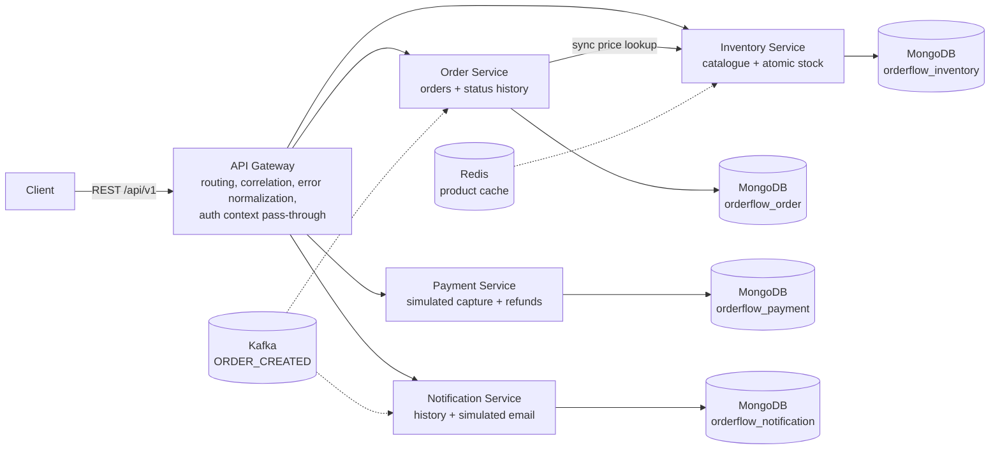
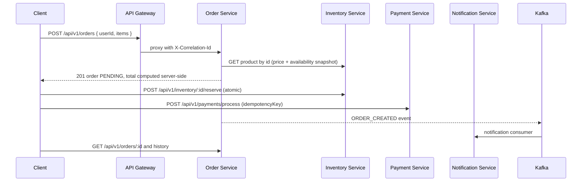

# OrderFlow

**Distributed e-commerce order management system — portfolio / interview project.**

> **Build status: Phase 3 core backend implemented and smoke-tested.** Four domain services
> (Order, Inventory, Payment, Notification) and the API Gateway are runnable with independent
> MongoDB databases, Swagger, tests and Docker Compose. This branch adds only a simple JWT login,
> one Kafka notification event, Redis product caching and a small React frontend. Advanced saga,
> outbox, DLQ and distributed-transaction patterns are intentionally out of scope.

---

## 1. Overview

OrderFlow demonstrates understandable backend engineering: independently deployable NestJS
services, MongoDB data ownership with Mongoose, REST APIs with DTO validation, Swagger/OpenAPI,
automated tests and Docker Compose. The simplified additions stay intentionally small: basic JWT
auth, one Kafka event, Redis product caching and a React storefront.

Phase 3 delivers the **synchronous domain APIs**:

- server-resolved order pricing (client-supplied prices/totals are rejected by DTO whitelisting),
- atomic inventory reservations with `availableQuantity` / `reservedQuantity` and no overselling,
- idempotent simulated payments with refunds and status history,
- notification history with read state and simulated email delivery,
- one gateway with centralized routing, correlation propagation and normalized upstream errors.

Checkout stays synchronous. Kafka is used only to create an `ORDER_CREATED` notification, not to
coordinate a distributed workflow. The short current-state guide is
[docs/simple-architecture.md](docs/simple-architecture.md).

## 2. Requirement ambiguity resolved

The brief says "**four** independently deployable microservices" but then lists **five** components
(API Gateway, Order, Inventory, Payment, Notification).

**Resolution:** the four *domain* microservices are Order, Inventory, Payment and Notification.
The API Gateway is treated as independently deployable **edge infrastructure**, not a domain
microservice, and owns no business data. Total backend deployables: 5 (4 domain services + gateway).

Other explicit decisions: identity is planned in the Order Service (no fifth Auth service), and the
shopping cart is client-side (no Cart service). The database layer uses MongoDB/Mongoose; rationale
in [docs/technical-decisions.md](docs/technical-decisions.md).

## 3. Architecture



Detailed boundaries, communication rules and deployment view: [docs/architecture.md](docs/architecture.md).

## 4. Service responsibilities

| Deployable | Owns | Current responsibility | Simple addition in this track |
| --- | --- | --- | --- |
| API Gateway | No business DB | Route `/api/v1/{orders,inventory,payments,notifications}`, forward correlation headers, normalize upstream failures as `502`, expose route table | JWT verification and `ADMIN` check for product changes |
| Order Service | `orders` | Create/get/list/cancel, guarded status transitions, status history, server-side price lookup from Inventory | Register/login, publish one `ORDER_CREATED` event |
| Inventory Service | `products` | Product CRUD/deactivate, availability checks, atomic reserve/release/restock, oversell prevention | Redis cache for product reads only |
| Payment Service | `payments` | Simulated success/failure, idempotency key, full/partial refunds, payment history | None |
| Notification Service | `notifications` | Create/history/customer queries, read state, simulated email + resend | Consume `ORDER_CREATED` and write a notification |
| Web | Static assets | Not implemented yet | Small React storefront deployed on Vercel |

## 5. Technology stack

| Layer | Choice |
| --- | --- |
| Backend | Node.js 20+, TypeScript 5, NestJS 10, REST, **Mongoose**, class-validator, Swagger/OpenAPI |
| Data / infra | MongoDB 7 (local single-node replica set `rs0`), Redis 7 for product caching, Kafka 3.x for one notification event |
| Hosting | GitHub source; Vercel for the React frontend; local Docker Compose for the backend stack |
| Quality | Jest, Supertest, ESLint, Prettier, simple GitHub Actions checks |
| Frontend | React 18, TypeScript, Vite, Tailwind CSS, React Router, TanStack Query |

No Nx/Turborepo, no relational database or code-generation ORM, no native `bcrypt` build, no
CDC/Debezium, no extra logging framework — see ADRs in
[docs/technical-decisions.md](docs/technical-decisions.md).

## 6. Repository layout

```text
orderflow/
├── apps/
│   ├── api-gateway/          # edge service (NestJS)
│   ├── order-service/        # domain service (NestJS + Mongoose)
│   ├── inventory-service/    # domain service (NestJS + Mongoose)
│   ├── payment-service/      # domain service (NestJS + Mongoose)
│   ├── notification-service/ # domain service (NestJS + Mongoose)
│   └── web/                  # React + Vite storefront (Vercel target)
├── libs/
│   ├── contracts/            # minimal ORDER_CREATED event type and topic constant
│   ├── common/               # config, bootstrap, filters, logging, health, infra clients
│   └── testing/              # MongoDB memory-server test harness
├── deploy/                   # shared Dockerfile + Compose files; local deployment guide
├── docs/                     # simple-architecture guide, API, reference docs, checklist
├── vercel.json               # Vercel build config for apps/web
├── .github/workflows/        # simple CI checks
├── .env.example
├── package.json              # npm workspaces
└── tsconfig.base.json
```

## 7. Current request flow

Checkout uses synchronous REST. Kafka is only a notification side effect; there is no saga or
distributed transaction.



`GET /api/v1/gateway/routes` returns the live proxy table;
`GET /api/v1/gateway/auth-context` shows the auth context forwarded to services. The short guide is
[docs/simple-architecture.md](docs/simple-architecture.md). The older event and lifecycle documents
are reference material only.

## 8. Local setup

Install dependencies and verify formatting:

```powershell
npm install
npm run format:check
```

Run everything with Docker Compose (recommended):

```powershell
copy .env.example .env
npm run dev:stack
npm run dev:down
```

Or run infrastructure in Compose and Node processes on the host:

```powershell
npm run dev:infra
npm run dev:gateway        # http://localhost:3000
npm run dev:order          # http://localhost:3001
npm run dev:inventory      # http://localhost:3002
npm run dev:payment        # http://localhost:3003
npm run dev:notification   # http://localhost:3004
```

Useful endpoints:

| URL | Purpose |
| --- | --- |
| `http://localhost:3000/api/v1/health` | Gateway liveness |
| `http://localhost:3000/api/v1/gateway/routes` | Live proxy route table |
| `http://localhost:3000/api/v1/docs` | Gateway Swagger UI |
| `http://localhost:3001/api/v1/docs` | Order Service Swagger UI |
| `http://localhost:3002/api/v1/docs` | Inventory Service Swagger UI |
| `http://localhost:3003/api/v1/docs` | Payment Service Swagger UI |
| `http://localhost:3004/api/v1/docs` | Notification Service Swagger UI |

Every service also exposes `/api/v1/health` and `/api/v1/health/ready`. Local MongoDB runs as a
**single-node replica set (`rs0`)**; host-side Node processes use `directConnection=true`, while
Compose overrides the URI with `replicaSet=rs0` and the internal `mongo` hostname. Local Compose
disables MongoDB auth; hosted environments use Atlas credentials in secrets. See
[deploy/README.md](deploy/README.md).

Verification commands:

```powershell
npm run build
npm run typecheck
npm run lint
npm run format:check
npm test
```

Domain-specific suites: `npm run test:order`, `test:inventory`, `test:payment`,
`test:notification`, `test:gateway`. Database tests use `mongodb-memory-server`, so no running
Compose stack is required for `npm test`.

## 9. Documentation

- [Simple architecture guide — start here](docs/simple-architecture.md)
- [Architecture](docs/architecture.md)
- [API documentation](docs/api-documentation.md)
- [Database design](docs/database-design.md)
- [Event-driven architecture (reference only)](docs/event-driven-architecture.md)
- [Order lifecycle (reference only)](docs/order-lifecycle.md)
- [Technical decisions / ADRs](docs/technical-decisions.md)
- [Implementation checklist](docs/implementation-checklist.md)
- [Deployment (local + hosted)](deploy/README.md)
- [Package install commands](docs/install-commands.md)

## 10. Out of scope on purpose

Advanced patterns are not implemented: Saga orchestration, Transactional Outbox, retry topics, DLQ,
distributed transactions, refresh tokens, rate limiting, OpenTelemetry, read replicas, real payment
providers, Kubernetes manifests and service meshes. The simple behavior above is what to explain in
an interview.
