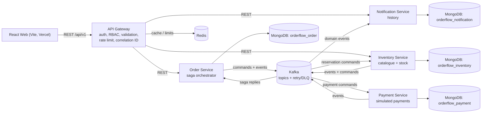
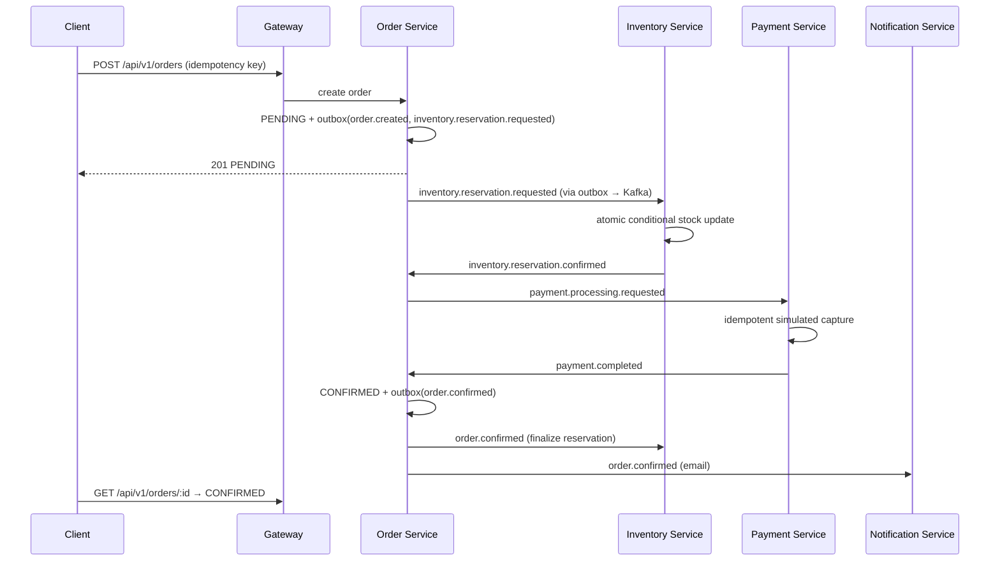

# OrderFlow

**Distributed e-commerce order management system — portfolio / interview project.**

> **Build status: Phase 2 backend foundation implemented and smoke-tested.**
> One minimal NestJS service (Order Service foundation) plus shared infrastructure are implemented.
> Domain microservices, auth, Kafka workflows and the frontend remain on hold. See
> [docs/implementation-checklist.md](docs/implementation-checklist.md) for progress.

---

## 1. Overview

OrderFlow demonstrates production-oriented backend engineering: independently deployable NestJS
services, MongoDB data ownership with Mongoose, Kafka event-driven choreography with saga
orchestration, transactional outbox, idempotent consumers, Redis caching/rate limiting, automated
tests, Docker Compose, CI, and a React storefront deployed on Vercel.

It is deliberately **not** a CRUD demo: the order workflow is asynchronous, failure-aware and
compensatable, and every cross-service state change is event-backed.

## 2. Requirement ambiguity resolved

The brief says "**four** independently deployable microservices" but then lists **five** components
(API Gateway, Order, Inventory, Payment, Notification).

**Resolution:** the four *domain* microservices are Order, Inventory, Payment and Notification.
The API Gateway is treated as independently deployable **edge infrastructure**, not a domain
microservice, and owns no business data. Total deployables: 6 (4 domain services + gateway + web).

Other explicit decisions: identity lives in the Order Service (no fifth Auth service), and the
shopping cart is client-side (no Cart service). The database layer was revised to
MongoDB/Mongoose during Phase 1 — rationale in
[docs/technical-decisions.md](docs/technical-decisions.md).

## 3. Architecture



Detailed boundaries, communication rules and deployment view: [docs/architecture.md](docs/architecture.md).

## 4. Service responsibilities

| Deployable | Owns | Key responsibility |
| --- | --- | --- |
| API Gateway | No business DB; Redis for limits | Single entry point, JWT verification, RBAC, DTO validation, error mapping, correlation IDs, rate limiting, routing |
| Order Service | `orderflow_order` (users, orders with embedded items, status history, outbox) | Order lifecycle, saga orchestration, compensation, idempotency |
| Inventory Service | `orderflow_inventory` (products with embedded stock, reservations, outbox) | Atomic reservation/release, oversell prevention, expiry worker, catalogue cache |
| Payment Service | `orderflow_payment` (payments with embedded transactions, outbox) | Simulated capture/refund, idempotency, transaction history |
| Notification Service | `orderflow_notification` (notifications, dedupe) | Consume events, simulated email, history |
| Web | Static assets | Storefront and admin UI; gateway-only API calls |

## 5. Technology stack

| Layer | Choice |
| --- | --- |
| Backend | Node.js 20+, TypeScript 5, NestJS 10, REST, **Mongoose**, class-validator, Swagger/OpenAPI |
| Frontend | React 18, TypeScript, Vite, Tailwind CSS, React Router, TanStack Query |
| Data / infra | MongoDB 7 (Atlas M10+ hosted, single-node replica set locally), Redis 7, Apache Kafka 3.x, Docker + Docker Compose |
| Hosting | GitHub, Vercel (web), Render (5 backend Docker services), MongoDB Atlas, Upstash Redis, Confluent Cloud |
| Quality | Jest, Supertest, ESLint, Prettier, GitHub Actions |

No Nx/Turborepo, no relational database or code-generation ORM, no native `bcrypt` build, no
CDC/Debezium, no extra logging framework — see ADR-013 and the deployment guide.

## 6. Repository layout

```text
orderflow/
├── apps/
│   ├── api-gateway/          # edge service (NestJS)
│   ├── order-service/        # domain service (NestJS + Mongoose)
│   ├── inventory-service/    # domain service (NestJS + Mongoose)
│   ├── payment-service/      # domain service (NestJS + Mongoose)
│   ├── notification-service/ # domain service (NestJS + Mongoose)
│   └── web/                  # React + Vite (deployed on Vercel)
├── libs/
│   ├── contracts/            # shared event/DTO types (no runtime deps)
│   ├── common/               # config, filters, logging, guards, outbox helpers
│   └── testing/              # factories and test infrastructure helpers
├── docs/                     # architecture, database, events, lifecycle, decisions, API, checklist
├── deploy/                   # Dockerfiles and Compose files; local + hosted deployment guide
├── .github/workflows/        # CI (Phase 7)
├── .env.example
├── package.json              # npm workspaces
└── tsconfig.base.json
```

## 7. Event flow (happy path, simplified)



Full contract, retries, DLQ and failure flows:
[docs/event-driven-architecture.md](docs/event-driven-architecture.md) and
[docs/order-lifecycle.md](docs/order-lifecycle.md).

## 8. Local setup

Install dependencies and verify formatting:

```powershell
npm install
npm run format:check
```

Start infrastructure and the runnable backend foundation:

```powershell
copy .env.example .env
npm run dev:infra                         # MongoDB rs0 + Redis + Kafka
npm run dev:order                         # Order Service foundation on http://localhost:3001
```

Or start everything, including the backend container, with Docker Compose:

```powershell
npm run dev:stack
npm run dev:down
```

Useful endpoints once running:

| URL | Purpose |
| --- | --- |
| `http://localhost:3001/api/v1/health` | Liveness |
| `http://localhost:3001/api/v1/health/ready` | MongoDB/Redis/Kafka readiness |
| `http://localhost:3001/api/v1/docs` | Swagger UI |

Local MongoDB runs as a **single-node replica set (`rs0`)** so Mongoose multi-document transactions
work. Host-side Node processes use `directConnection=true`; Compose overrides the URI with
`replicaSet=rs0` and the internal `mongo` hostname. Hosted environments use MongoDB Atlas M10+ and
the managed services listed in [deploy/README.md](deploy/README.md).

Verification commands:

```powershell
npm run build
npm run typecheck
npm run lint
npm run format:check
npm run test:order
```

## 9. Documentation

- [Architecture](docs/architecture.md)
- [Database design](docs/database-design.md)
- [API documentation](docs/api-documentation.md)
- [Event-driven architecture](docs/event-driven-architecture.md)
- [Order lifecycle](docs/order-lifecycle.md)
- [Technical decisions / ADRs](docs/technical-decisions.md)
- [Implementation checklist](docs/implementation-checklist.md)
- [Deployment (local + hosted)](deploy/README.md)
- [Package install commands](docs/install-commands.md)

## 10. Future improvements

Out of scope but documented for interviews: refresh tokens, Debezium CDC outbox, per-tenant rate
limits, WebSockets/SSE order updates, real payment provider adapter, Kubernetes manifests,
distributed tracing (OpenTelemetry), read replicas, splitting Atlas databases into separate clusters.
