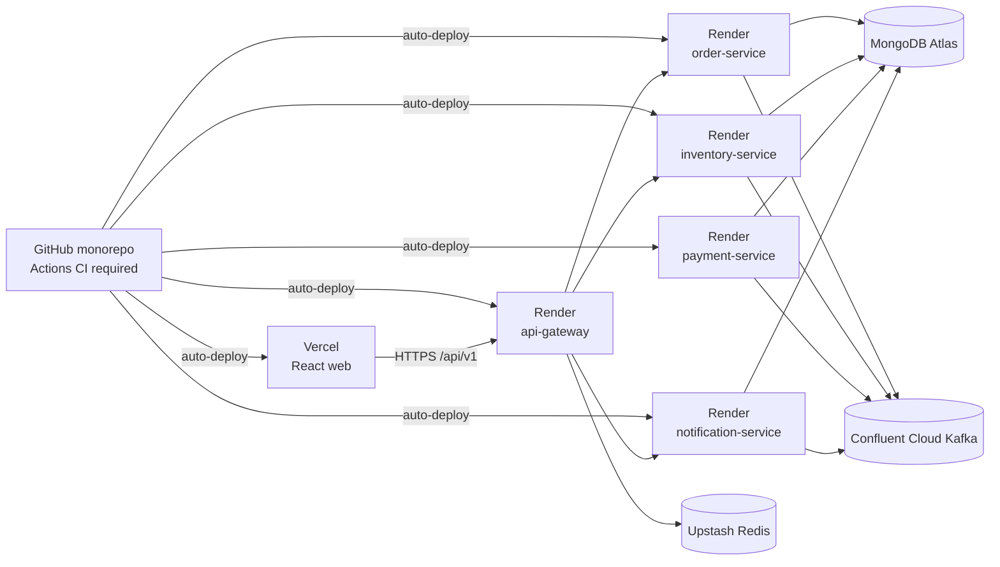

# Deployment guide

**Status:** Phase 2 local infrastructure files now exist. Only the Order Service foundation has a
Dockerfile; gateway and domain services remain future work. Docker was not available in the build
environment, so Compose files were syntax-checked but not started.

## 1. Hosting model

| Concern | Local development | Hosted |
| --- | --- | --- |
| Source | Working copy | **GitHub** monorepo, branch protection on `main`, required CI checks |
| Web | Vite dev server on 5173 | **Vercel** (static build from `apps/web`) |
| Backend | Docker Compose, ports 3000–3004 | **Render** Docker Web Services, one per deployable, always-on instances |
| Database | MongoDB 7 single-node replica set `rs0` | **MongoDB Atlas M10+** (four databases in one cluster) |
| Cache / limits | Redis 7 container | **Upstash Redis** (TLS/RESP endpoint) |
| Messaging | Kafka 3.x KRaft container | **Confluent Cloud** (topics, ACLs, retry/DLQ) |
| Secrets | `.env` (gitignored) | Vercel/Render/GitHub Actions secret stores |



## 2. Local Docker Compose (Phase 2 scope)

Files:

- `docker-compose.infra.yml`: MongoDB replica set `rs0`, Redis, Kafka only.
- `docker-compose.yml`: the same infrastructure plus the Order Service foundation container.

Commands from the repository root:

```powershell
npm run dev:infra     # infrastructure only
npm run dev:order     # build/run the local Node process against host-side infra
npm run dev:stack     # infrastructure + backend container
npm run dev:down      # stop and remove containers/networks
```

MongoDB must run as a **replica set** because Mongoose multi-document transactions and the outbox
relay lease require it:

```yaml
mongo:
  image: mongo:7
  command: ["--replSet", "rs0", "--bind_ip_all"]
  healthcheck:
    test: ["CMD", "mongosh", "--quiet", "--eval", "db.adminCommand('ping')"]
  volumes:
    - mongo-data:/data/db
```

A one-time init container runs `rs.initiate({_id:'rs0',members:[{_id:0,host:'mongo:27017'}]})`.
`depends_on` health conditions gate the backend services on Mongo, Redis and Kafka readiness.

Host ports currently published: MongoDB 27017, Redis 6379, Kafka 9092 and the Order Service
foundation 3001. Web 5173 and gateway 3000 are future phases; the other domain service ports remain
internal until their services are implemented.

## 3. GitHub

- Single repository; `.env` and secrets never committed (`.gitignore` already excludes them).
- GitHub Actions runs install, lint, typecheck, unit, integration and build on every push/PR.
- `main` is protected: CI must pass before Vercel/Render auto-deploy consumes the commit.
- `.env.example` documents every variable without real values.

## 4. Vercel (web)

- Import the GitHub repo; set **Root Directory** to `apps/web`.
- Framework preset: Vite; build command `npm run build`, output `dist` (adjusted for the workspace root).
- Environment: `VITE_API_BASE_URL=https://<gateway-host>/api/v1`.
- Preview deployments per PR use the same gateway staging URL.
- Gateway `CORS_ORIGINS` must include the Vercel production domain and preview domain pattern.

Vercel is used only for the React client. Long-running NestJS processes and Kafka consumers are
not deployed as serverless functions.

## 5. Render (backend)

Five separate Docker Web Services from the same repo/commit:

| Service | Internal port | Key env vars |
| --- | --- | --- |
| `api-gateway` | 3000 | `JWT_SECRET`, `REDIS_URL`, `ORDER_SERVICE_URL`, `INVENTORY_SERVICE_URL`, `NOTIFICATION_SERVICE_URL`, `CORS_ORIGINS` |
| `order-service` | 3001 | `MONGODB_URI_ORDER`, `KAFKA_BROKERS`, `JWT_SECRET` |
| `inventory-service` | 3002 | `MONGODB_URI_INVENTORY`, `KAFKA_BROKERS`, `REDIS_URL` |
| `payment-service` | 3003 | `MONGODB_URI_PAYMENT`, `KAFKA_BROKERS`, `PAYMENT_SIMULATION_MAX_DELAY_MS` |
| `notification-service` | 3004 | `MONGODB_URI_NOTIFICATION`, `KAFKA_BROKERS` |

- Health check path: `/health/ready` on each service.
- Use always-on (paid) instances: Kafka consumers must not be stopped by free-tier sleeping.
- Render internal service URLs are injected into the gateway; no service is publicly exposed
  except the gateway.
- Rollback: redeploy the previous green commit from GitHub.

## 6. Managed data infrastructure

- **MongoDB Atlas M10+**: one cluster, four databases (`orderflow_*`). M10+ is chosen because
  multi-document transactions require a replica set; verify current Atlas tier limits before
  choosing a cheaper tier. Each service receives only its own URI via Render secrets.
- **Upstash Redis**: catalogue cache and rate-limit counters, TLS endpoint.
- **Confluent Cloud**: create the application topics plus `<topic>.retry.1`, `.retry.2` and `.dlq`
  (see [docs/event-driven-architecture.md](../docs/event-driven-architecture.md)). ACLs restrict
  each service to its own topics/consumer groups. No Schema Registry is added.

## 7. Deployment flow

1. Developer pushes to a branch → GitHub Actions validates → Vercel preview is created.
2. PR merged to `main` → CI must pass → Vercel production + Render services deploy automatically.
3. Verify `/health/ready` on all five backend services, then smoke-test `POST /api/v1/auth/login`
   and `GET /api/v1/products` against the gateway.
4. Secrets are rotated in the Vercel/Render/Atlas dashboards, never in repository files.
