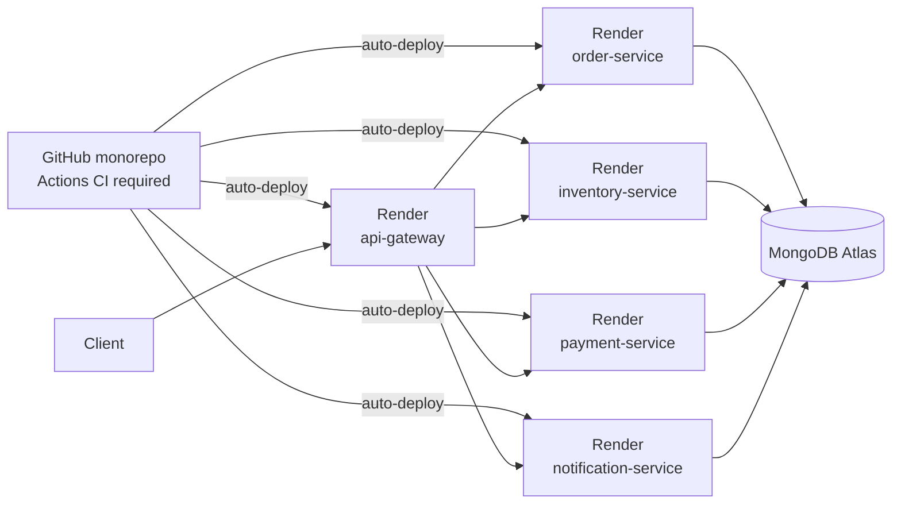

# Deployment guide

**Status:** Phase 3 local deployment is implemented and verified. One parameterized backend image
builds the gateway and all four domain services; Docker Compose runs MongoDB, Redis, Kafka and the
five NestJS deployables. The simplified track adds a Vercel build for `apps/web`; hosted backend
details below remain reference material.

## 1. Hosting model

| Concern | Local development | Hosted |
| --- | --- | --- |
| Source | Working copy | **GitHub** monorepo, branch protection on `main`, required CI checks |
| Web | Vite dev server on `5173` (simple app in this track) | **Vercel** static build from `apps/web` |
| Backend | Docker Compose, ports 3000–3004 | Render notes are reference only; not required for this track |
| Database | MongoDB 7 single-node replica set `rs0` | MongoDB Atlas notes are reference only |
| Cache / limits | Redis 7 container for product reads only | Managed Redis notes are reference only |
| Messaging | Kafka 3.x KRaft container for `ORDER_CREATED` only | Managed Kafka notes are reference only |
| Secrets | `.env` (gitignored) | Vercel/Render/GitHub Actions secret stores |



## 2. Local Docker Compose (Phase 3 scope)

Files:

- `docker-compose.infra.yml`: MongoDB replica set `rs0`, Redis, Kafka only.
- `docker-compose.yml`: the same infrastructure plus API Gateway, Order, Inventory, Payment and
  Notification services.
- `Dockerfile`: one shared multi-stage image. Build stage runs `npm run build`; runtime stage
  installs production deps and copies all service `dist` folders. `SERVICE` selects the entrypoint:
  `node apps/${SERVICE}/dist/main.js`.

Commands from the repository root:

```powershell
npm run dev:infra     # infrastructure only
npm run dev:gateway   # local gateway process on 3000
npm run dev:order     # local Order Service process on 3001
npm run dev:inventory # local Inventory Service process on 3002
npm run dev:payment   # local Payment Service process on 3003
npm run dev:notification # local Notification Service process on 3004
npm run dev:stack     # build and run infrastructure + all five backend containers
npm run dev:down      # stop and remove containers/networks
```

MongoDB must run as a **replica set** because Mongoose multi-document transactions and the future
outbox relay require it:

```yaml
mongo:
  image: mongo:7
  command: ['--replSet', 'rs0', '--bind_ip_all']
  healthcheck:
    test: ["CMD-SHELL", "mongosh --quiet --eval \"db.adminCommand('ping')\""]
  volumes:
    - mongo-data:/data/db
```

A one-time init container runs `rs.initiate({_id:'rs0',members:[{_id:0,host:'mongo:27017'}]})`.
`depends_on` health conditions gate services on Mongo readiness. Local Compose intentionally runs
MongoDB **without auth**: enabling authorization together with a replica set requires a shared
`keyFile`, which adds secret handling to local development. Hosted Atlas clusters keep
authentication enabled, with credentials supplied only through `MONGODB_URI_*` secrets.

Host ports published by `docker-compose.yml`:

| Port | Service |
| --- | --- |
| 27017 | MongoDB `rs0` |
| 6379 | Redis |
| 9092 | Kafka |
| 3000 | API Gateway |
| 3001 | Order Service |
| 3002 | Inventory Service |
| 3003 | Payment Service |
| 3004 | Notification Service |

All five backend services expose `/api/v1/health`, `/api/v1/health/ready` and `/api/v1/docs`.
Compose healthchecks use `127.0.0.1` rather than `localhost`: Alpine resolves `localhost` to IPv6
first, while Nest binds the IPv4 `0.0.0.0` address. Smoke-check the stack with:

```powershell
docker compose --env-file .env -f deploy/docker-compose.yml config
npm run dev:stack
```

Then request `http://localhost:3000/api/v1/gateway/routes` and proxy a domain request such as
`http://localhost:3000/api/v1/inventory/products`. In hosted environments only the gateway is
publicly exposed; the direct service ports are published locally for debugging and Swagger access.

## 3. GitHub

- Single repository; `.env` and secrets never committed (`.gitignore` already excludes them).
- `.github/workflows/ci.yml` runs install, build (backend + web), typecheck, lint, format check and
  all tests on every push and pull request to `main`.
- `.env.example` documents every variable without real values.

## 4. Vercel (web)

- Import the GitHub repo; set **Root Directory** to `apps/web`.
- Framework preset: Vite; build command `npm run build`, output `dist`.
- Environment: `VITE_API_URL=https://<gateway-host>` (no trailing `/api`).
- `apps/web/vercel.json` rewrites unknown paths to `index.html` for React Router.
- Gateway `CORS_ORIGINS` must include the Vercel production domain and preview domain pattern.
- Vercel hosts only the React client; NestJS services and Kafka consumers are not serverless
  functions.

## 5. Render (backend)

Five separate Docker Web Services from the same repo/commit use the same build context and
`dockerfile: deploy/Dockerfile`; set the build arg `SERVICE` per service.

| Service | Internal port | Key env vars |
| --- | --- | --- |
| `api-gateway` (build arg `api-gateway`) | 3000 | `CORS_ORIGINS`, `ORDER_SERVICE_URL`, `INVENTORY_SERVICE_URL`, `PAYMENT_SERVICE_URL`, `NOTIFICATION_SERVICE_URL` |
| `order-service` | 3001 | `MONGODB_URI_ORDER`, `INVENTORY_SERVICE_URL`, `REDIS_URL`, `KAFKA_BROKERS` |
| `inventory-service` | 3002 | `MONGODB_URI_INVENTORY` |
| `payment-service` | 3003 | `MONGODB_URI_PAYMENT` |
| `notification-service` | 3004 | `MONGODB_URI_NOTIFICATION` |

- Docker build context: repository root; Dockerfile: `deploy/Dockerfile`; build arg:
  `SERVICE=<service-folder>`.
- Health check path: `/api/v1/health`; readiness: `/api/v1/health/ready`.
- Use always-on (paid) instances when Phase 4 Kafka consumers are added.
- Render internal service URLs are injected into the gateway; only the gateway is publicly exposed.
- Rollback: redeploy the previous green commit from GitHub.

## 6. Managed data infrastructure

- **MongoDB Atlas M10+**: one cluster, four databases (`orderflow_order`, `orderflow_inventory`,
  `orderflow_payment`, `orderflow_notification`). M10+ is chosen because multi-document transactions
  require a replica set. Each service receives only its own URI via Render secrets.
- **Upstash Redis**: planned for catalogue cache and rate-limit counters (Phase 5), TLS endpoint.
- **Confluent Cloud**: application topics plus retry/DLQ topics will be created in Phase 4
  (see [../docs/event-driven-architecture.md](../docs/event-driven-architecture.md)). No Schema
  Registry is added.

## 7. Deployment flow

1. Developer pushes to a branch → CI validates → Vercel preview is created (once web exists).
2. PR merged to `main` → CI must pass → Vercel production + Render services deploy automatically.
3. Verify `/api/v1/health/ready` on all five backend services, then smoke-test
   `GET /api/v1/gateway/routes`, `GET /api/v1/inventory/products` and `POST /api/v1/orders`
   against the gateway.
4. Secrets are rotated in the Vercel/Render/Atlas dashboards, never in repository files.
