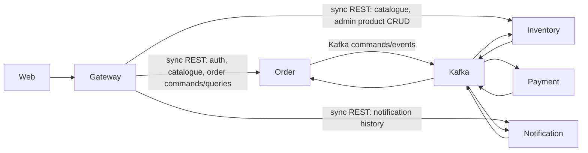

# Architecture

**Status:** proposed and accepted into Phase 1; implementation pending approval.

## 1. Context and goals

OrderFlow splits a storefront into four domain microservices plus an edge gateway. Goals:

- Independent deployability and data ownership (no shared tables, no cross-service joins).
- Asynchronous, failure-tolerant order processing with a saga and compensations.
- Interview-legible simplicity: no service mesh, no Kubernetes, no CDC plugin.

## 2. Service boundaries

| Service | Bounded context | Owns | Does **not** own |
| --- | --- | --- | --- |
| API Gateway | Edge / API composition | Routing, auth verification, RBAC, validation, rate limits, correlation IDs | Business tables, domain rules |
| Order Service | Orders + customer identity | `users`, `orders`, `order_items`, `outbox`, `processed_events` | Stock, payments, notifications |
| Inventory Service | Catalogue + stock | `products`, `inventory`, `inventory_reservations`, `outbox`, `processed_events` | Orders, users, payments |
| Payment Service | Money movement (simulated) | `payments`, `payment_transactions`, `outbox`, `processed_events` | Stock, order state |
| Notification Service | User communication | `notifications`, `processed_events` | Business decisions |
| Web | Presentation | Local cart (localStorage), auth token | Server-side truth |

### Why identity is in Order Service

A dedicated Auth service would be a fifth domain service, contradicting the agreed service count.
Registration/login are customer-facing prerequisites to placing an order, and the only data needed
by other services is `userId` (stored as a UUID reference). Therefore Order Service owns users and
issues JWTs. The gateway verifies the JWT statelessly with the shared secret; it never queries the
user table. Trade-off: adding a real Auth service later means moving one table and one endpoint
group — documented as a future improvement.

## 3. Communication rules

| Interaction | Style | Rationale |
| --- | --- | --- |
| Web → Gateway | Synchronous REST | Browser client |
| Gateway → Order (create order, get order, cancel) | Synchronous REST | Immediate acknowledgement / read model |
| Gateway → Inventory (list products, product detail) | Synchronous REST + Redis cache | Query with tight latency; cache reduces load |
| Order → Inventory (reserve/confirm/release) | **Asynchronous Kafka** | Long-running workflow, must not block HTTP request |
| Order → Payment (capture/refund) | **Asynchronous Kafka** | Failure compensation, idempotency |
| Any → Notification | **Asynchronous Kafka** | Side effect; must not affect order success |
| Gateway → Notification (history) | Synchronous REST | Admin/user read |

Rule: **commands** express intent (`inventory.reservation.requested`), **events** state facts
(`inventory.reservation.confirmed`). Both use the same envelope and outbox infrastructure.

## 4. Deployment view

### Local development

- One Docker Compose network; only gateway (3000) and web (5173) publish host ports.
- Domain services listen on internal ports 3001–3004, reachable only inside the network.
- MongoDB 7 runs as a single-node replica set (`rs0`) with four databases; one Redis instance; one
  Kafka broker (KRaft). The replica set is required for Mongoose transactions.
- Each service has its own Dockerfile, health endpoint and env file. Indexes are declared in
  Mongoose schemas and built at startup; there is no migration tool.
- Kafka UI is optional and not added (not in agreed stack).

### Hosted

- GitHub is the source of truth; Actions CI gates deployments.
- React web deploys to Vercel from `apps/web`; the gateway and four domain services deploy as
  independent Render Docker Web Services.
- MongoDB Atlas M10+ (one cluster, four databases), Upstash Redis and Confluent Cloud Kafka are
  managed services; secrets come from platform secret stores, never from the repository.
- Full details: [deploy/README.md](../deploy/README.md).

## 5. Cross-cutting concerns

| Concern | Approach |
| --- | --- |
| Config | `@nestjs/config` + class-validator env schema in `@orderflow/common`; fail fast at boot |
| Logging | JSON lines via a thin wrapper over Nest `Logger`; `correlationId` on every line |
| Errors | Global filter → `{ statusCode, code, message, correlationId }`; no stack traces in production |
| Validation | `ValidationPipe({ whitelist: true, forbidNonWhitelisted: true, transform: true })` at gateway **and** services |
| Auth | bcryptjs password hashes; HS256 JWT; `@Roles('ADMIN')` guard; shared secret from env |
| Rate limiting | Redis fixed/sliding window keyed by user ID or IP; stricter limit on auth endpoints |
| Versioning | URL prefix `/api/v1`; Kafka topic suffix `.v1` plus envelope `version` |
| Health | `/health` (liveness) and `/health/ready` (DB/Kafka/Redis readiness) per service |
| Observability | Structured logs + correlation IDs now; OpenTelemetry listed as future work |

## 6. Consistency model

- Each service owns its MongoDB database; **all** state changes plus outbox documents happen in one
  Mongoose multi-document transaction (replica set required), giving atomicity within a service.
- Cross-service consistency is **eventual**, driven by the saga with compensating actions.
- Kafka is at-least-once; consumers deduplicate by `(eventId, consumerGroup)`.
- No distributed transactions, no two-phase commit.

## 7. Key trade-offs

| Decision | Benefit | Cost |
| --- | --- | --- |
| Saga orchestration in Order Service | Clear workflow ownership, easy to reason about | Order Service is a coordinator (not a god object: logic lives in state machine + handlers) |
| Four MongoDB databases, one cluster | Strong ownership boundary, simple local dev | One cluster is a local SPOF (acceptable in dev); Atlas can split clusters later |
| Outbox polling instead of CDC | No Debezium, works with Mongoose + MongoDB | ~1s publish latency vs near-real-time CDC |
| Client-side cart | No Cart service, fewer moving parts | Cart not synced across devices (documented limitation) |
| Shared JWT secret | No auth service dependency | All services must be trusted; rotate via env |

See [technical-decisions.md](docs/technical-decisions.md) for the numbered ADRs.
