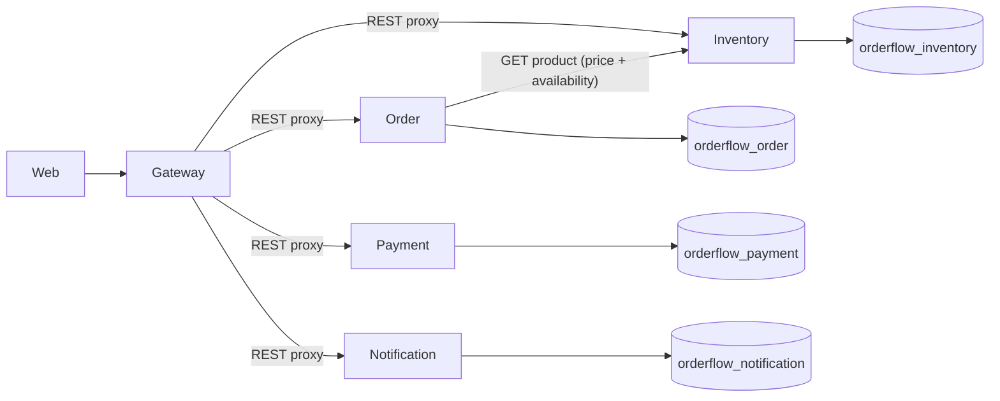
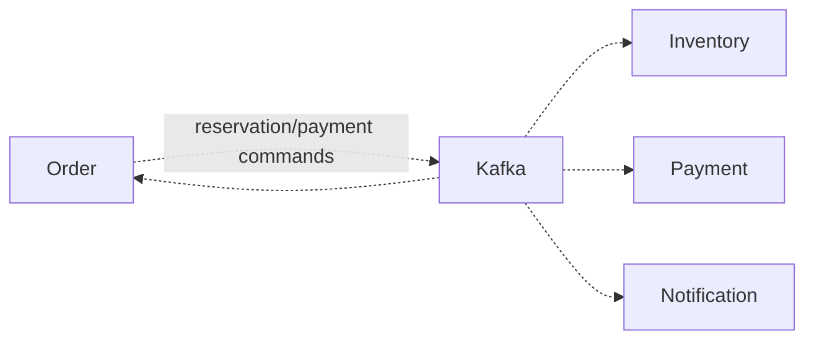

# Architecture

> **Start with [simple-architecture.md](simple-architecture.md)** for the current, short version.
> This document keeps the fuller boundary and data-ownership detail.

**Status:** Phase 3 core REST services are implemented and verified. The simplified additions are
JWT auth, one Kafka notification event, Redis product caching and a React frontend. Saga
orchestration, outbox relay, DLQ and rate limiting remain out of scope.

## 1. Context and goals

OrderFlow splits a storefront into four domain microservices plus an edge gateway. Goals:

- Independent deployability and data ownership (no shared tables, no cross-service joins).
- Server-side truth for money and stock: clients send product IDs and quantities only.
- Failure-aware APIs: guarded order transitions, atomic stock updates, idempotent payments.
- Interview-legible simplicity: one shared bootstrap, no service mesh, no Kubernetes, no CDC plugin.

## 2. Service boundaries

| Service | Bounded context | Owns now | Phase 4+ collections / work |
| --- | --- | --- | --- |
| API Gateway | Edge / API composition | No business DB; route table and auth-context pass-through | Redis rate-limit counters |
| Order Service | Orders | `orders` (embedded items, status history) | `users`, `outbox`, `processed_events`, saga state |
| Inventory Service | Catalogue + stock | `products` (price, `availableQuantity`, `reservedQuantity`, active flag) | `inventory_reservations`, `outbox`, `processed_events`, expiry worker |
| Payment Service | Money movement (simulated) | `payments` (status, refunds, history, `idempotencyKey`) | `payment_transactions`, `outbox`, `processed_events` |
| Notification Service | User communication | `notifications` (type, delivery status, read state) | `processed_events`, dedupe, Kafka consumers |
| Web | Presentation | Not implemented | Local cart (localStorage), auth token |

### Why identity lives in Order Service (planned)

A dedicated Auth service would be a fifth domain service, contradicting the agreed service count.
Registration/login are customer-facing prerequisites to placing an order, and other services need
only a `userId` reference. Phase 3 does **not** implement login or JWT verification: the gateway
exposes `GET /api/v1/gateway/auth-context` and forwards `authorization` / `x-user-id` headers so an
auth guard can be added without changing route contracts.

## 3. Communication rules

### Current: synchronous REST

| Interaction | Style | Phase 3 behaviour |
| --- | --- | --- |
| Client → Gateway | REST `/api/v1` | Gateway forwards the path/query/body and returns the upstream status and envelope |
| Gateway → Order | REST | Create/get/list/cancel, status and payment-status updates |
| Gateway → Inventory | REST | Catalogue CRUD, availability and atomic reserve/release/restock |
| Gateway → Payment | REST | Simulated process/refund, history and customer/order queries |
| Gateway → Notification | REST | Create, history, customer queries, read/resend |
| Order → Inventory | Synchronous lookup | Resolves `sku`, `name`, `priceCents` server-side and checks an availability snapshot; it does **not** reserve stock yet |

### Future: asynchronous commands/events (Phase 4)

Commands express intent (`inventory.reservation.requested`); events state facts
(`inventory.reservation.confirmed`). Both will use the shared envelope and outbox infrastructure.
No Kafka topics, producers, consumers, saga handlers or outbox relay are active in Phase 3.

## 4. Deployment view

### Local development

- One Docker Compose network from `deploy/docker-compose.yml`.
- Gateway (3000) plus all four domain services (3001–3004) publish host ports for API/Swagger smoke
  tests. In hosted environments only the gateway is publicly exposed.
- One shared multi-stage image, `deploy/Dockerfile`, takes `SERVICE=<workspace-folder>` as a build
  arg: `order-service`, `inventory-service`, `payment-service`, `notification-service` or
  `api-gateway`. Compose passes that arg per service.
- MongoDB 7 runs as a single-node replica set (`rs0`) with four databases. Redis and Kafka are
  started for future phases; business services set `*_ENABLED=false` except the Order Service's
  existing readiness client.
- Each service has `/api/v1/health`, `/api/v1/health/ready`, Swagger at `/api/v1/docs`,
  config-driven env validation and graceful shutdown.
- Mongoose indexes are declared in schemas and created via `MONGODB_AUTO_INDEX`; no migration tool.

### Hosted

- GitHub is the source of truth; Actions CI gates deployments (Phase 7).
- React web deploys to Vercel from `apps/web`; the gateway and four domain services deploy as
  independent Render Docker Web Services using `deploy/Dockerfile`.
- MongoDB Atlas M10+ (one cluster, four databases), Upstash Redis and Confluent Cloud Kafka are
  managed services; secrets come from platform secret stores, never from the repository.
- Full details: [../deploy/README.md](../deploy/README.md).

## 5. Cross-cutting concerns

| Concern | Approach |
| --- | --- |
| Config | `@nestjs/config` + class-validator env schema in `@orderflow/common`; fail fast at boot |
| Bootstrap | Shared `bootstrapService()` applies global prefix `/api/v1`, ValidationPipe, CORS, filters, interceptor, Swagger and logging to every service |
| Logging | JSON lines via `AppLogger`; `correlationId` on every request response/log line |
| Errors | Global filter → `{ statusCode, code, message, correlationId }`; gateway preserves upstream status/envelope and emits the same shape with `BAD_GATEWAY` for unreachable upstreams |
| Validation | `ValidationPipe({ whitelist: true, forbidNonWhitelisted: true, transform: true })`; DTOs reject client prices/totals and unknown fields |
| Correlation | Common middleware generates/accepts `X-Correlation-Id`; gateway forwards it to upstream services and rewrites the response envelope's `correlationId` |
| Auth | Integration point only: gateway resolves and forwards `authorization` / `x-user-id`; no JWT verification or RBAC in Phase 3 |
| Rate limiting | Deferred to Phase 5 (Redis); no limiter active in Phase 3 |
| Versioning | URL prefix `/api/v1`; future Kafka topic suffix `.v1` plus envelope `version` |
| Health | `/health` (liveness) and `/health/ready` (MongoDB/Redis/Kafka readiness) per service |
| Observability | Structured logs + correlation IDs now; OpenTelemetry listed as future work |

## 6. Consistency model

- Each service owns one MongoDB database and **never** queries another service's collections.
- Order creation resolves prices from Inventory over REST. If Inventory is unavailable, the
  request fails with the normalized gateway error (`502`) or the service's own upstream error.
- Inventory prevents overselling with an atomic conditional update:
  `availableQuantity >= quantity`, then `availableQuantity - quantity` and
  `reservedQuantity + quantity` in one document update. Release and restock use the inverse guards.
- Payment idempotency uses a unique `idempotencyKey`; duplicate or racing requests return the
  existing payment rather than charging twice.
- No distributed transactions, no outbox and no eventual-consistency guarantees yet. Phase 4 will
  add the saga, outbox relay and idempotent consumers with dedupe by event/consumer group.

## 7. Key trade-offs

| Decision | Benefit | Cost |
| --- | --- | --- |
| Synchronous price lookup in Phase 3 | Correct totals without trusting the client; simple to demo and test | Order creation depends on Inventory availability; no reservation is held yet |
| Atomic stock counters in one document | No oversell under concurrent reservations without a distributed lock | Reservation expiry must be added in Phase 4 |
| Idempotency key on payment document | Duplicate charges prevented even with concurrent requests | One stored payment per business key; retries return the original outcome |
| Shared Dockerfile with `SERVICE` arg | One build/runtime definition for all backend deployables | All dist folders are copied into the runtime image (small, acceptable for this project) |
| Gateway forwards validation to services | Each domain service remains independently safe when called directly | Gateway does not pre-validate proxied bodies; its own controllers use the same ValidationPipe |
| Auth as pass-through | Route contracts are stable when JWT/RBAC arrive | No enforcement in Phase 3; must not be treated as production auth |

See [technical-decisions.md](technical-decisions.md) for the numbered ADRs.
