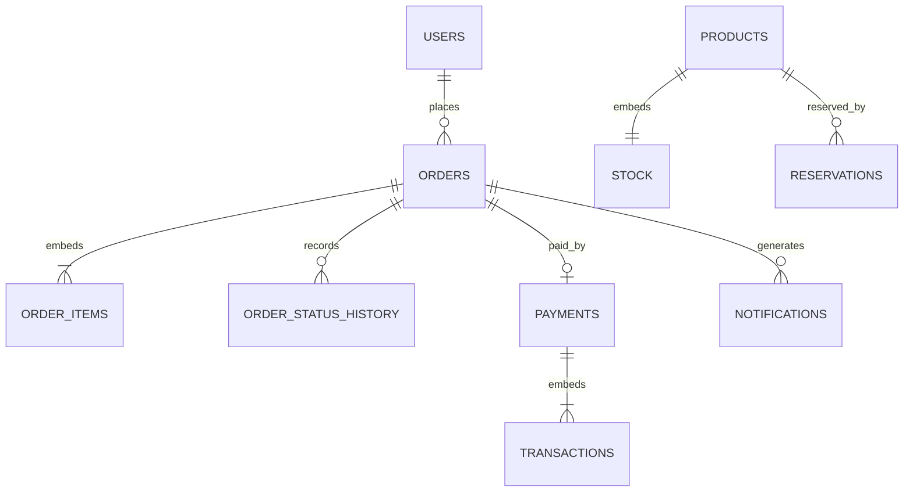

# Database design (reference)

> **Simplified scope:** the active collections are `orders`, `products`, `payments` and
> `notifications`. `outbox`, `processed_events`, `idempotency_keys`, saga state and reservation
> collections below are **not implemented**. See [simple-architecture.md](simple-architecture.md).

**Status:** implemented core schemas plus deferred reference sections.

## 1. Ownership rules

- One MongoDB cluster locally (single-node replica set `rs0`) and on Atlas, **four databases**:
  `orderflow_order`, `orderflow_inventory`, `orderflow_payment`, `orderflow_notification`.
- Each service has its own Mongoose schema set and connects with its own `MONGODB_URI_*`.
- Cross-service references are **plain UUID strings only**: no cross-database lookups, no `$lookup`
  across services, no shared collections.
- `_id` is a **UUID string** (`{ type: String, default: () => randomUUID() }`) so IDs in MongoDB,
  REST responses and Kafka events are identical — no ObjectId mapping layer.
- Timestamps use `timestamps: true` → `createdAt` / `updatedAt` as `Date`.
- Money is stored as **integer minor units** (`amountCents: number`, `min: 0`, safe-integer check)
  and transported in events as decimal strings via one formatting helper (ADR-015).
- Schemas use `strict: true`, `required`, `enum`, `min`, `max`, `match` validators. Unique rules are
  real MongoDB indexes, not application-only checks.
- Soft deletes are not used; cancellation is a status transition.
- Multi-document transactions use Mongoose sessions and require a replica set (ADR-017).

## 2. Logical ownership map



Relationships drawn between services are **logical only**. `ORDER_ITEMS`, `STOCK` and
`TRANSACTIONS` are embedded subdocuments, not separate collections.

## 3. Shared collections (in each publishing/consuming service)

### `outbox` — Order, Inventory and Payment only

| Field | Type | Validation / notes |
| --- | --- | --- |
| `_id` | string UUID | PK |
| `topic` | string | required, max 128 |
| `eventType` | string | required, max 128 |
| `partitionKey` | string | required (usually `orderId`) |
| `aggregateId` | string UUID | required |
| `payload` | object (`Mixed` strictly shaped in code) | required, full event envelope |
| `correlationId` | string UUID | required |
| `published` | boolean | required, default `false` |
| `publishedAt` | Date | optional |
| `lockedUntil` | Date | optional, relay lease |
| `attempts` | number | required, default 0 |
| `lastError` | string | optional |

Indexes:

- Partial index `{ published: 1, createdAt: 1 }` with `partialFilterExpression: { published: false }`.
- Index `{ lockedUntil: 1 }` for lease recovery.

Relay claim (a `lockedUntil` lease lets multiple relay instances run safely):

```ts
const job = await OutboxModel.findOneAndUpdate(
  {
    published: false,
    $or: [{ lockedUntil: { $exists: false } }, { lockedUntil: { $lt: new Date() } }],
  },
  { $set: { lockedUntil: new Date(Date.now() + 10_000) } },
  { sort: { createdAt: 1 } },
);
```

After Kafka ack, set `published: true`, `publishedAt`, increment `attempts`, clear `lockedUntil`.
A crashed relay is recovered when the lease expires. No event is silently dropped.

### `processed_events` — all consumers

| Field | Type | Validation / notes |
| --- | --- | --- |
| `eventId` | string UUID | part of compound unique key |
| `consumerGroup` | string | part of compound unique key |
| `processedAt` | Date | required |

Unique compound index `{ eventId: 1, consumerGroup: 1 }`. No TTL: dedupe must outlive any replay
window. Notification also uses its own `eventId` unique index for user-facing side effects.

## 4. `orderflow_order` (Order Service)

### `users`

| Field | Type | Validation / notes |
| --- | --- | --- |
| `_id` | string UUID | PK |
| `name` | string | required, max 120 |
| `email` | string | required, lowercase, `match` email regex, **unique index** |
| `passwordHash` | string | required (bcryptjs) |
| `role` | string enum | `CUSTOMER` / `ADMIN`, default `CUSTOMER` |
| `createdAt`, `updatedAt` | Date | timestamps |

### `orders`

| Field | Type | Validation / notes |
| --- | --- | --- |
| `_id` | string UUID | PK |
| `userId` | string UUID | required (logical reference to `users`) |
| `totalAmountCents` | number | required, `min: 0`, safe integer |
| `status` | string enum | `PENDING`, `INVENTORY_RESERVED`, `PAYMENT_PROCESSING`, `PAYMENT_CAPTURED`, `CONFIRMED`, `CANCELLING`, `CANCELLED` |
| `idempotencyKey` | string UUID | required |
| `items` | array of subdocuments | embedded, at least 1 item |
| `simulationFailureHint` | boolean | optional, demo-only flag passed through saga |
| `reservationExpired` | boolean | default `false` (expiry during payment) |
| `failureReason` | string | optional |

`items[]` subdocument: `productId` (UUID string), `quantity` (int `min: 1`), `unitPriceCents`
(int `min: 0`). Duplicate `productId` values are rejected by DTO validation before insert.

Indexes:

- Unique `{ userId: 1, idempotencyKey: 1 }` — duplicate checkout cannot create two orders.
- `{ userId: 1, createdAt: -1 }` — "my orders" page.
- `{ status: 1, updatedAt: 1 }` — saga recovery sweeps.

### `order_status_history`

| Field | Type | Validation / notes |
| --- | --- | --- |
| `_id` | string UUID | PK |
| `orderId` | string UUID | required (logical reference) |
| `fromStatus` | string enum | optional (null for initial transition) |
| `toStatus` | string enum | required |
| `reason` | string | optional |
| `eventId` | string UUID | optional (causing event) |
| `createdAt` | Date | required |

Index `{ orderId: 1, createdAt: 1 }`. Powers the tracking timeline. Kept separate from `orders`
because the timeline grows without bound.

`outbox` and `processed_events` as described above. An optional `idempotency_keys` collection may
be added later if HTTP response replay is required; the unique order index already prevents
duplicate orders.

## 5. `orderflow_inventory` (Inventory Service)

### `products` (catalogue + embedded stock)

| Field | Type | Validation / notes |
| --- | --- | --- |
| `_id` | string UUID | PK (also the `productId` used in events) |
| `name` | string | required, max 200 |
| `description` | string | optional |
| `priceCents` | number | required, `min: 0`, safe integer |
| `sku` | string | required, **unique index**, max 64 |
| `availableQuantity` | number | required, `min: 0`, integer |
| `reservedQuantity` | number | required, `min: 0`, integer |
| `createdAt`, `updatedAt` | Date | timestamps |

Price is the **source of truth**. Order Service reads it at checkout via a synchronous GET (or the
short-TTL Redis catalogue cache) and snapshots it into `orders.items[].unitPriceCents`.

Indexes: `{ sku: 1 }` unique, `{ updatedAt: -1 }` for cache invalidation scans.

### `reservations`

| Field | Type | Validation / notes |
| --- | --- | --- |
| `_id` | string UUID | PK |
| `orderId` | string UUID | required (logical reference) |
| `productId` | string UUID | required (logical reference to `products._id`) |
| `quantity` | number | required, `min: 1`, integer |
| `status` | string enum | `ACTIVE`, `CONFIRMED`, `RELEASED`, `EXPIRED` |
| `expiresAt` | Date | required |
| `createdAt`, `updatedAt` | Date | timestamps |

Indexes:

- Unique `{ orderId: 1, productId: 1 }` — duplicate reservation commands become no-ops.
- `{ status: 1, expiresAt: 1 }` — expiry worker scan.
- `{ orderId: 1 }` — confirm/release lookup.

Expired reservations are retained for audit; a partial TTL index may be added later for cleanup.

`outbox` and `processed_events` as described above.

## 6. `orderflow_payment` (Payment Service)

### `payments` (with embedded transactions)

| Field | Type | Validation / notes |
| --- | --- | --- |
| `_id` | string UUID | PK |
| `orderId` | string UUID | required, **unique index** (idempotent capture key) |
| `userId` | string UUID | required (logical reference) |
| `amountCents` | number | required, `min: 0`, safe integer |
| `status` | string enum | `PENDING`, `CAPTURED`, `FAILED`, `REFUNDED`, `REFUND_FAILED` |
| `idempotencyKey` | string UUID | required, **unique index** |
| `transactionReference` | string | required, **unique index**, max 64 |
| `failureReason` | string | optional |
| `transactions` | array of subdocuments | embedded, small (authorize/capture/refund) |
| `createdAt`, `updatedAt` | Date | timestamps |

`transactions[]` subdocument: `type` (`AUTHORIZATION`/`CAPTURE`/`REFUND`), `amountCents`, `status`
(`SUCCESS`/`FAILURE`), `externalReference` optional, `createdAt`.

Indexes: unique `orderId`, unique `idempotencyKey`, unique `transactionReference`, `{ userId: 1, createdAt: -1 }`.

`outbox` and `processed_events` as described above.

## 7. `orderflow_notification` (Notification Service)

### `notifications`

| Field | Type | Validation / notes |
| --- | --- | --- |
| `_id` | string UUID | PK |
| `eventId` | string UUID | required, **unique index** (dedupe of side effects) |
| `userId` | string UUID | required |
| `orderId` | string UUID | optional |
| `type` | string enum | `ORDER_CONFIRMED`, `PAYMENT_FAILED`, `ORDER_CANCELLED`, `PAYMENT_REFUNDED` |
| `channel` | string enum | `EMAIL` |
| `recipient` | string | required |
| `subject`, `body` | string | required |
| `status` | string enum | `SIMULATED` / `FAILED` |
| `createdAt` | Date | required |

Indexes: unique `{ eventId: 1 }`, `{ userId: 1, createdAt: -1 }`, `{ orderId: 1 }`.

`processed_events` as described above. Notification publishes no critical business events, so no
outbox is planned for this service.

## 8. Concurrency and oversell prevention

Reservation uses one atomic document update inside a Mongoose session:

```ts
const result = await ProductModel.updateOne(
  { _id: productId, availableQuantity: { $gte: quantity } },
  {
    $inc: { availableQuantity: -quantity, reservedQuantity: quantity },
    $set: { updatedAt: new Date() },
  },
  { session },
);
if (result.modifiedCount === 0) throw new InsufficientStockError(productId);
```

The reservation document and outbox document are inserted in the **same session**. Schema `min: 0`
validators plus the `{ availableQuantity: { $gte: quantity } }` filter make overselling impossible
even when many Kafka consumers reserve the same product. Redis locks are never the source of truth
(ADR-007).

## 9. Transaction boundaries

Each `session.withTransaction()` wraps exactly one service's work:

1. Order create → insert `orders` + `outbox` documents.
2. Reservation → `$inc` product stock + insert `reservations` + `outbox`.
3. Payment capture/refund → update `payments` + append embedded transaction + `outbox`.
4. Consumer handling → update own document(s) + insert `processed_events`.

Kafka offset commit happens **after** the Mongo transaction commits; the dedupe index closes the
crash window between them.

## 10. Schema/index bootstrapping

- No migration tool: Mongoose schemas define indexes; `Model.init()` / startup index sync builds
  them (autoIndex enabled in development, explicitly managed in production).
- A seed script inserts catalogue products with initial stock.
- Index changes are reviewed in code review; no destructive collection drops in this project.
