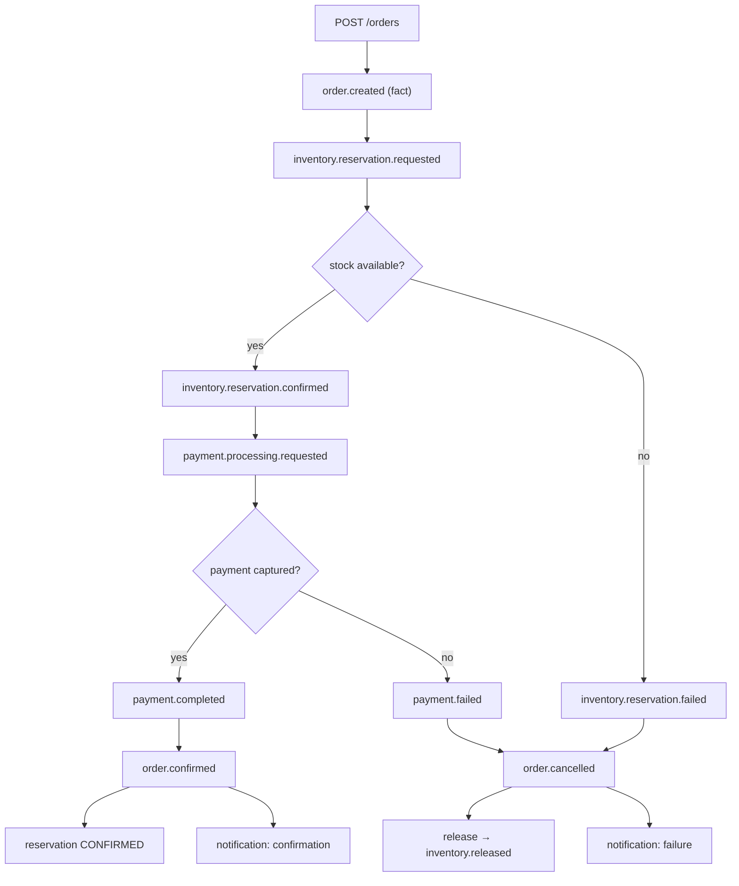
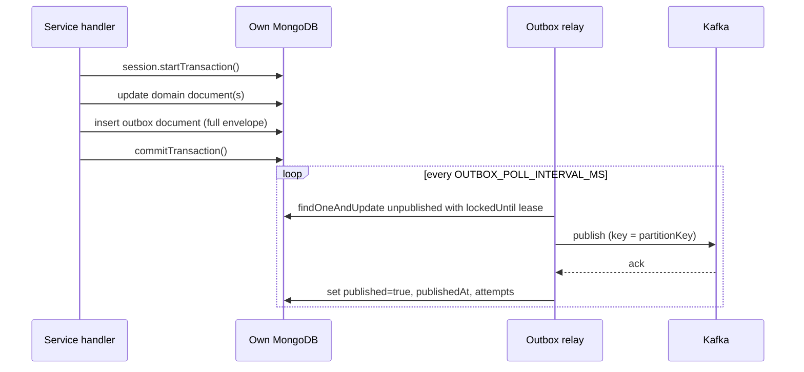

# Event-driven architecture

**Status:** proposed contract. Types land in `libs/contracts` in Phase 2; Kafka wiring in Phase 4.

## 1. Delivery semantics

- Kafka provides **at-least-once** delivery; duplicates and redelivery are expected.
- Producers assign a UUID `eventId`; consumers deduplicate on `(eventId, consumerGroup)` in the same
  MongoDB transaction as their state change.
- Consumer offsets are committed only after the DB transaction and dedupe insert succeed. If the
  process dies between commit and Kafka offset commit, the redelivered event is a no-op.
- All traffic is keyed by `orderId` (or `productId` for catalogue events) so events for the same
  aggregate stay ordered within a partition.

## 2. Envelope (v1)

```ts
export interface EventEnvelope<TPayload> {
  eventId: string;        // UUID, deduplication key
  eventType: string;      // e.g. 'inventory.reservation.confirmed'
  version: 1;             // schema version
  correlationId: string;  // propagated from X-Correlation-Id, or generated at origin
  causationId?: string;   // eventId that triggered this event (saga tracing)
  occurredAt: string;     // ISO-8601 UTC
  producer: string;       // 'order-service' | 'inventory-service' | ...
  payload: TPayload;
}
```

Versioning rules: additive optional fields bump nothing; breaking changes create `.v2` topics and a
new payload type. Consumers for v1 keep running until explicitly retired.

## 3. Topic catalogue

| Topic | Type | Producer | Consumers |
| --- | --- | --- | --- |
| `order.created.v1` | fact | Order | Audit/analytics only (no current side effect) |
| `inventory.reservation.requested.v1` | command | Order | Inventory |
| `inventory.reservation.confirmed.v1` | fact | Inventory | Order |
| `inventory.reservation.failed.v1` | fact | Inventory | Order |
| `payment.processing.requested.v1` | command | Order | Payment |
| `payment.completed.v1` | fact | Payment | Order |
| `payment.failed.v1` | fact | Payment | Order, Notification |
| `order.confirmed.v1` | fact | Order | Inventory (finalize reservation), Notification |
| `order.cancelled.v1` | fact | Order | Inventory (release), Notification |
| `inventory.released.v1` | fact | Inventory | Order (audit/reconciliation) |
| `payment.refund.requested.v1` | command | Order | Payment |
| `payment.refunded.v1` | fact | Payment | Order, Notification |
| `payment.refund.failed.v1` | **added** fact | Payment | Order (keeps order CONFIRMED, raises alert) |

`payment.refund.failed.v1` is an addition to the suggested list: the brief requires refund handling
but provides no failure event. Without it, a failed refund would silently leave inconsistent state.

For each application topic, retry and dead-letter topics exist:
`<topic>.retry.1`, `<topic>.retry.2`, `<topic>.dlq`.

## 4. Flow diagram



## 5. Transactional outbox



- Publishing and state change are atomic **within** the service database (one Mongoose session).
- A failed publish increments `attempts`; after `CONSUMER_MAX_RETRIES` the document is marked with
  `lastError` and surfaced in logs. It is never silently dropped.
- A `lockedUntil` lease lets another relay instance take over if the publisher crashes.
- Polling was chosen over Debezium CDC to keep the stack small (ADR-006).

## 6. Consumer retries and DLQ

1. Consumer receives event, checks `processed_events`; if present → ack, no work.
2. Handler runs in a DB transaction; on success, insert dedupe row and commit.
3. On transient failure (DB/Kafka unavailable, 5xx): publish envelope to `retry.1` with delay, ack
   original, then `retry.2`, then `dlq` after 3 attempts.
4. On permanent failure (validation/schema mismatch): publish straight to `<topic>.dlq`.
5. DLQ messages are logged with full envelope and correlation ID. No automatic replay in Phase 4;
   a replay script is a future improvement.

## 7. Idempotency layers

| Layer | Key | Effect |
| --- | --- | --- |
| HTTP checkout | `(userId, idempotencyKey)` | Same request returns same order, no duplicates |
| Reservation | `(orderId, productId)` unique | Duplicate reservation command is a no-op |
| Payment | `orderId` unique | Duplicate capture command never charges twice |
| Consumer | `(eventId, consumerGroup)` | Duplicate delivery never re-applies side effects |
| Notification | `eventId` unique | No duplicate emails |

## 8. Event flow invariants

- A state transition and its outgoing event(s) are committed together.
- A consumer never writes another service's collections.
- Commands may be ignored if they no longer apply to the current state (e.g. release for an
  already-released reservation), but the event is still recorded as processed.
- Every event keeps the originating `correlationId` so the whole saga can be traced in logs.
