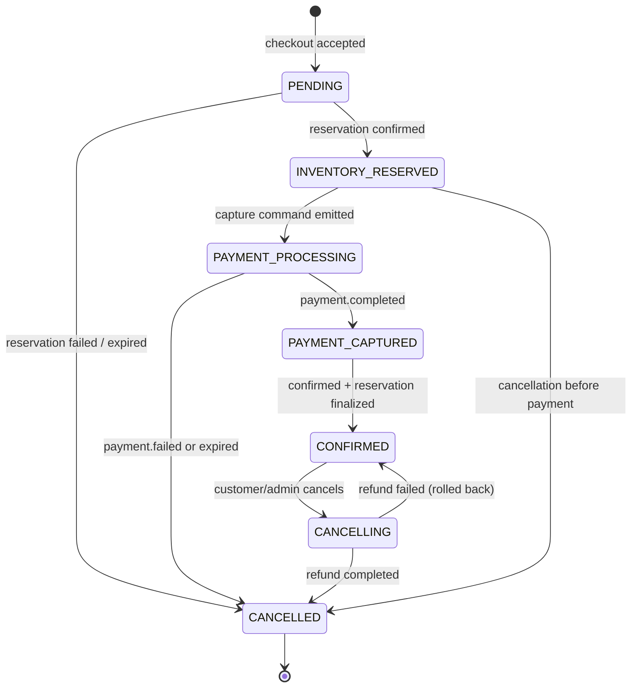

# Order lifecycle and saga (reference only)

> **Simplified scope:** the implemented lifecycle is the Phase 3 REST status flow
> (`PENDING` → `CONFIRMED` / `CANCELLED`) with status history. The saga state machine and outbox
> events below are **not implemented**. See [simple-architecture.md](simple-architecture.md).

**Status:** reference design only for the deferred distributed workflow.

## 1. State machine

Every transition writes the new status **and** its outgoing outbox event(s) in one transaction.
Transitions are guarded: an event applicable to an older state is ignored if the order has moved on.

## 2. Happy path

1. Customer registers/logs in; gateway issues JWT.
2. Customer browses cached catalogue (`GET /api/v1/products`).
3. Cart is held client-side; checkout sends `[{ productId, quantity }]` plus `Idempotency-Key`.
4. Order Service loads authoritative prices from Inventory (REST/cache), computes total, inserts
   `orders` + `order_items` + `outbox(order.created, inventory.reservation.requested)` as **PENDING**.
5. `201 Created` returns immediately with `PENDING`; the saga continues asynchronously.
6. Inventory consumes the reservation command, runs the conditional `UPDATE`, inserts a reservation
   row (`ACTIVE`, `expiresAt = now + RESERVATION_TTL_MINUTES`) and publishes
   `inventory.reservation.confirmed`.
7. Order transitions to `INVENTORY_RESERVED` → `PAYMENT_PROCESSING`, emits
   `payment.processing.requested` (amount, orderId, idempotencyKey, simulation hint).
8. Payment inserts a payment row (unique `orderId`), simulates 0–1500 ms latency, sets `CAPTURED`
   or `FAILED`, publishes `payment.completed` / `payment.failed`.
9. On `payment.completed`, Order moves to `CONFIRMED` and emits `order.confirmed`.
10. Inventory marks the reservation `CONFIRMED`; Notification writes and "sends" the confirmation.
11. Customer polls `GET /api/v1/orders/:id` and sees `CONFIRMED`.

## 3. Failure scenarios and compensations

| Scenario | Detection | Compensation | Final state |
| --- | --- | --- | --- |
| Insufficient stock | Conditional UPDATE affects 0 rows | `inventory.reservation.failed` → no charge attempted | `CANCELLED` |
| Product missing / inactive | Catalogue lookup 404 | `inventory.reservation.failed` | `CANCELLED` |
| Payment failed | `payment.failed` | Emit `order.cancelled` → Inventory releases stock → Notification failure email | `CANCELLED` |
| Duplicate checkout | Unique `(userId, idempotencyKey)` | Return existing order (same `201`/`200` body) | unchanged |
| Duplicate Kafka delivery | `(eventId, consumerGroup)` dedupe | Ack without side effects | unchanged |
| Kafka handler failure | Exception in consumer | Retry topics → DLQ; state unchanged until success | pending transition |
| Reservation expires before payment | Expiry worker | `inventory.reservation.failed(EXPIRED)` + release; Order cancels if still PENDING/INVENTORY_RESERVED | `CANCELLED` |
| Reservation expires while payment in flight | `reservation_expired=true` on order | When `payment.completed` arrives, auto-refund instead of confirming | `CANCELLING` → `CANCELLED` |
| Customer cancels confirmed order | `POST /orders/:id/cancel` | `payment.refund.requested` → `payment.refunded` → `order.cancelled` → stock release + email | `CANCELLED` |
| Refund fails | `payment.refund.failed` | Restore `CONFIRMED`, log alert; stock stays reserved | `CONFIRMED` |
| Outbox publish fails | Relay `attempts`/`last_error` | Retry; never drop; alert after threshold | eventual |

## 4. Reservation timeout reconciliation

The expiry worker scans `inventory_reservations WHERE status = 'ACTIVE' AND expires_at < now()`,
marks them `EXPIRED`, releases stock atomically and emits `inventory.released` plus
`inventory.reservation.failed`. TTL (default 15 min) is deliberately much larger than the payment
simulation (≤1.5 s), so expiry-during-payment is rare but explicitly handled:

- Order stores `reservation_expired` when the expiry event arrives during `PAYMENT_PROCESSING`.
- On `payment.completed` with that flag, Order emits `payment.refund.requested` rather than
  `order.confirmed`. We refund rather than re-reserve, because stock may already be sold to
  someone else — a safe, explainable business rule.

## 5. Cancellation ordering rule

For a **confirmed** order, refund comes first; inventory is released only after `payment.refunded`.
This prevents freeing stock while the customer has still been charged. For an **unpaid** order,
release happens immediately via `order.cancelled`.

## 6. Order history

`order_status_history` records `(fromStatus, toStatus, reason, eventId, occurredAt)` for each
transition. `GET /api/v1/orders/:id` returns the current state plus this timeline, which powers the
tracking page and makes saga behaviour auditable in interviews.

## 7. Why orchestration, not choreography

Order Service owns the workflow state and decides the next command, which makes state guards and
compensations explicit and testable in one place. Services remain autonomous: they only react to
commands and publish facts about their own data. The orchestrator holds no other service's tables.
